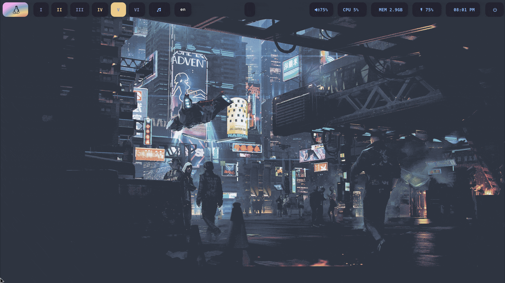
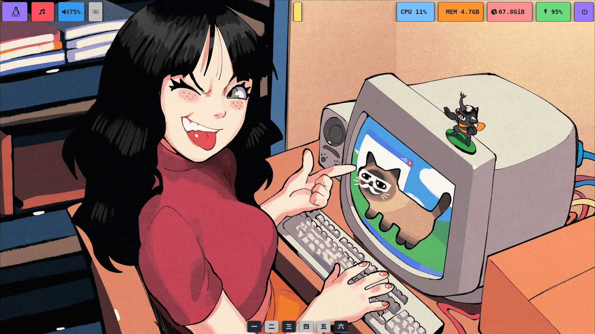
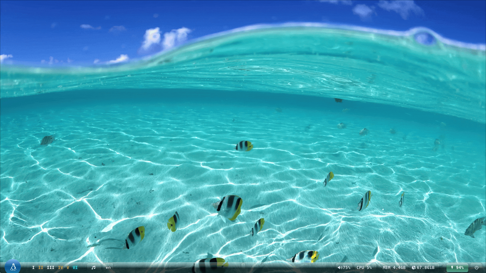
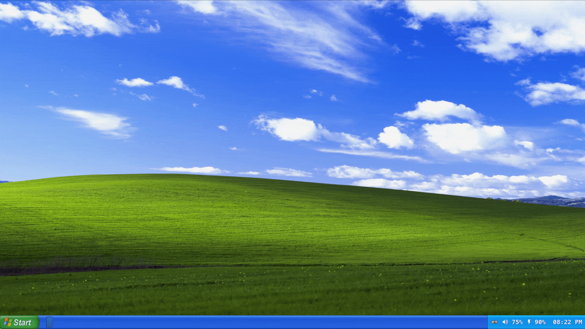
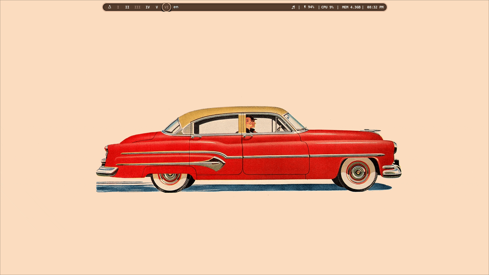
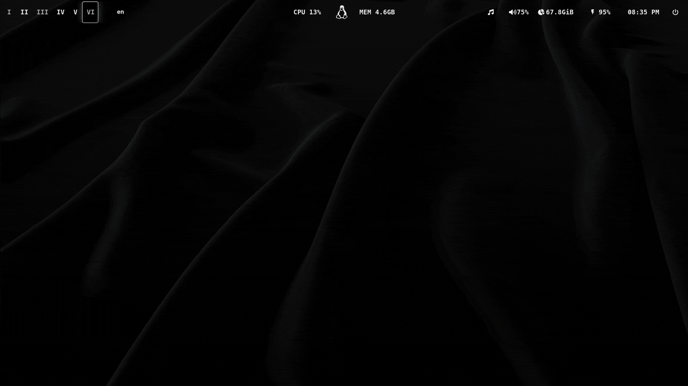
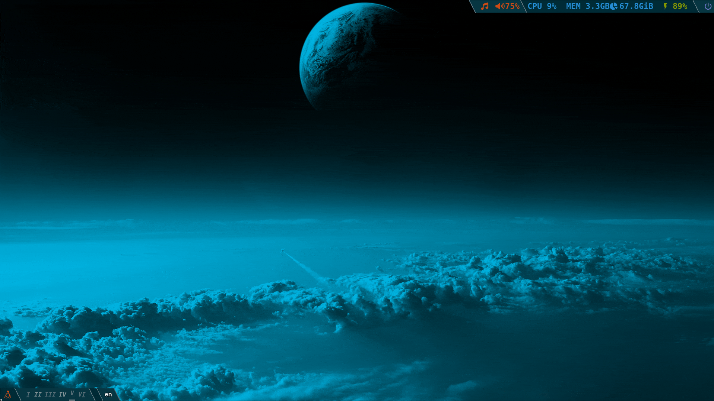
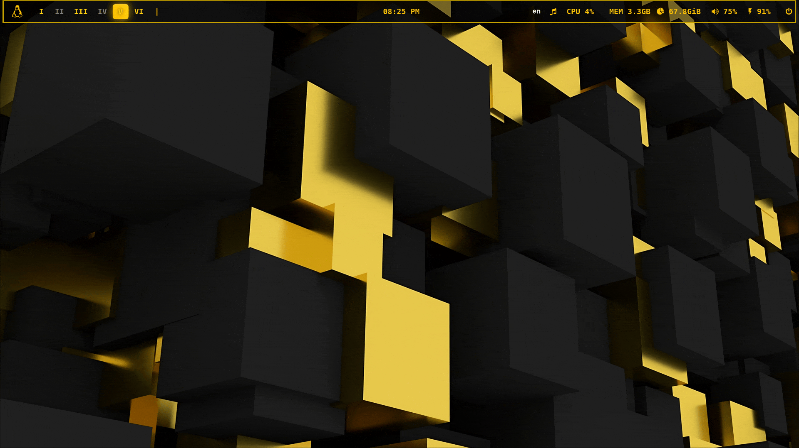
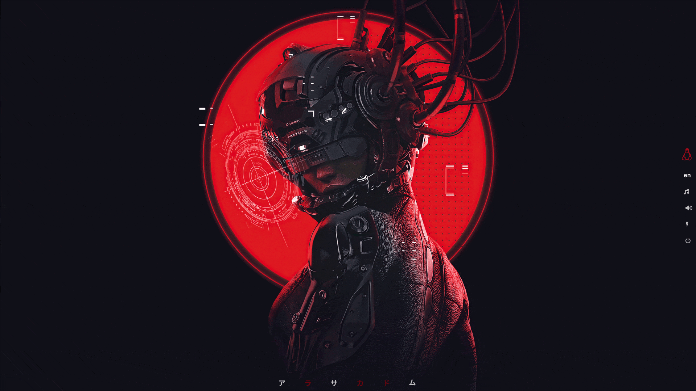
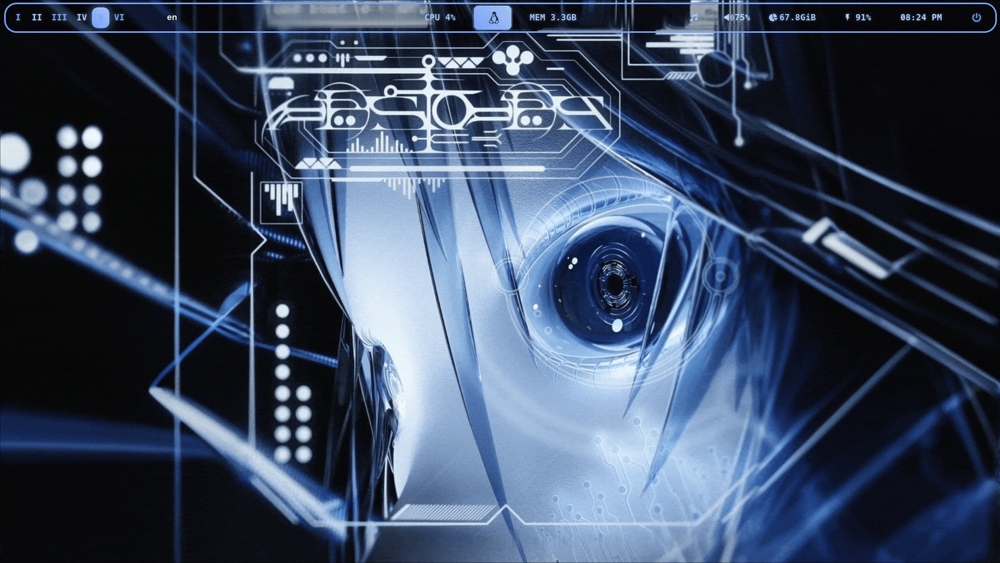

# MHD RiceInstaller

A collection of rice configurations for a Hyprland desktop, plus an automated
installer that sets the whole thing up in one command.

- Demo:


## Features

- **Complete Wayland setup**: Hyprland, Kitty, Mako, Waybar, Rofi menus, Fastfetch and more
- **13 rices**: switch themes at runtime, colours follow into Kitty, Rofi, Waybar, tmux and Neovim
- **Productivity scripts**: audio switcher, cheatsheets, keyboard layouts, power menu, wallpaper and rice selection
- **Neovim IDE**: fully configured, with LSP support and a per-rice colour scheme
- **Zsh shell**: syntax highlighting, autosuggestions, history substring search, Starship prompt
- **Rice creator**: build your own rice from the terminal with the `create_rice` command
- **Automated installer**: one-command setup, including optional SDDM theme, GRUB theme and a local llama.cpp build

---

| Bubble | Rainbow |
|--------|---------|
|  |  |

| Frutiger | WinXP |
|----------|-------|
|  |  |

| Cream | Mono |
|-------|------|
|  |  |

| Solarized | Yellowpunk |
|-----------|-------------|
|  |  |

| Redpunk | y2k |
|---------|-----|
|  |  |

Three more rices ship without a demo recording: **H3cker**, **Gentoo** and
**mhd_rice**. Pick any of them with `rice-selector`.

## Requirements

- **Arch Linux or a derivative** (EndeavourOS, CachyOS, Garuda, ...). The
  installer detects these through `/etc/os-release` and installs packages with
  `paru`. It also runs on other distributions, but skips the package step and
  tells you what to install.
- **Hyprland with lua configuration support.** The rice ships `hyprland.lua`
  rather than the older `hyprland.conf`, so it needs a Hyprland build that
  reads lua config. The installer checks for this and warns you if the running
  version cannot load it.
- `rofi` and ImageMagick are required by the menus and wallpaper thumbnails.
- A Nerd Font for the icons. `fonts/` ships MesloLGM, which is the closest
  match; any Nerd Font works.

### If Hyprland misbehaves after installing

Config written for a newer Hyprland than the one running is quietly ignored or
rejected, which leaves the window manager half-configured with no obvious
error. After installing, or after a Hyprland update, check:

```sh
hyprctl configerrors
```

The installer runs this for you after it reloads the config and prints
anything it finds.

## Installation

```sh
git clone https://github.com/MHD-GDev/RiceInstaller.git
cd RiceInstaller
chmod +x RiceInstaller.sh
./RiceInstaller.sh
```

The script can be started from any directory, and re-running it is safe: it
retries what failed, keeps backups instead of deleting anything, and creates
timestamped backups of `~/.config/hypr` and of your bash dotfiles.

During the install it asks what to set up:

- **Build type** - gaming, programming, both or neither. This picks which extra
  packages to install and whether VSCode is configured.
- **GPU** - Nvidia, Intel, AMD, hybrid, or skip. The matching driver and
  compute packages are installed.
- **Branch** - optional extra package groups for gamedev, gaming, programming
  or Steam Deck.
- **Extras** - the SDDM login theme, the GRUB theme, and a llama.cpp build for
  local LLMs.

## Manual installation

1. Copy `ConfigFiles` into your `.config` directory.
2. Copy `.zshrc` into your home directory.
3. Install the packages:

   ```sh
   paru -Syu --needed --noconfirm
   paru -S --needed --noconfirm $(cat arch-rice-wayland-packs.txt)
   ```

   Remember to install the driver packages for your GPU as well.

4. If you want the zsh plugins that `.zshrc` sources, copy the contents of
   `plugins/` to `/usr/share/zsh/plugins/`.
5. Restart Hyprland, or log out and back in.

## After installing

- `rice-selector` switches the whole theme. `ALT + SPACE` opens it.
- `wallpaper-selector` picks a wallpaper for the current rice
  (`SUPER + ALT + W`).
- `create_rice` scaffolds a new rice you can edit yourself.
- `power-menu` locks, logs out, reboots or shuts down.
- Your AI models, if you built llama.cpp, go in `~/.local/share/AI-Models`.

## Acknowledgments

- [OliveThePuffin](https://github.com/OliveThePuffin/yorha-grub-theme) for the GRUB theme.
- [stepanzubkov](https://github.com/stepanzubkov/where-is-my-sddm-theme) for the SDDM theme.

## License

GPLv3, see [LICENCE](LICENCE). The vendored zsh plugins under `plugins/` are
MIT licensed by their respective authors.